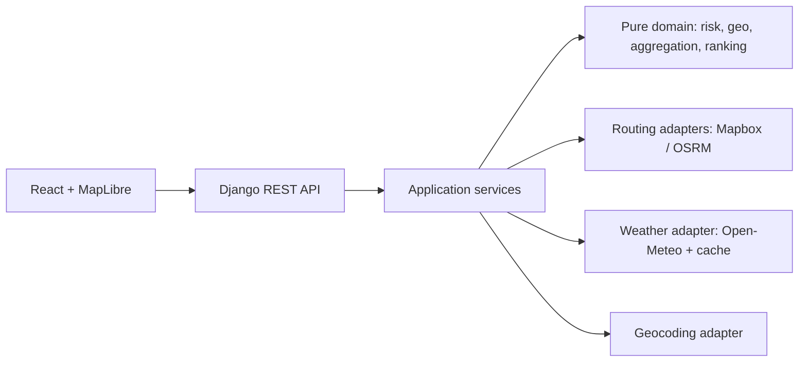

# TruckSafe — Weather-Aware Truck Routing

[](https://github.com/OWNER/REPOSITORY/actions/workflows/ci.yml)

TruckSafe compares driving routes using departure time, load weight, ETA-based weather checkpoints, and deterministic risk ranking. It is informational decision support only—not certified trucking guidance. Drivers must follow official restrictions, company policy, and current road conditions.

## Quick start

```powershell
copy .env.example .env
make install
make dev-backend
# in another terminal: make dev-frontend
```

The backend serves `/api/health`, `/api/geocode`, `/api/analyze`, and `/api/heatmap`. Mapbox is server-side only; OSRM is the keyless routing fallback and Open-Meteo supplies forecast data.

## Architecture



The domain layer has no Django, HTTP, environment, or provider dependencies. Services orchestrate routing, cumulative ETA, weather interpolation, mile ownership, and presentation. The frontend renders route/checkpoint GeoJSON layers and preloads all 49 heatmap hours; slider changes use `setPaintProperty` without network requests.

## Risk logic and assumptions

- **A1:** boundaries are lower-inclusive and half-open: wind `<25`, `[25,35)`, `[35,45)`, `[45,55)`, `≥55`; rain/snow use the same lower-inclusive bands and strict `>1.00`/`>3.0` No Travel edges. Values are never rounded before classification.
- **A2:** sustained 10 m wind is classified; gust is displayed for awareness and is not classified.
- **A3:** rain is `rain + showers`; snow is `snowfall`; units are mph and inches/hour.
- **A4:** checkpoint risk is the maximum of wind, rain, snow after load escalation.
- **A5:** checkpoints are at 0, each selected interval (10/25/50), and destination; near-end regular points are dropped.
- **A6:** each checkpoint owns midpoint-to-midpoint miles, so risk totals use distance rather than checkpoint counts.
- **A7:** average risk is distance-weighted over known miles; unknown miles are excluded and reported.
- **A8:** any No Travel checkpoint blocks a route; blocked routes are never recommended. If all are blocked, the API returns no recommendation and a least-risk comparison with delay advice.
- **A9:** ranking key is blocked, No Travel miles, Severe miles, High miles, average risk, unknown miles, duration, route id.
- **A10:** ETA uses cumulative segment durations with a 62 mph maximum-average-speed floor. Rest/HOS breaks are not modeled.
- **A11:** weather is linearly interpolated between hourly values; missing brackets and out-of-horizon ETAs become UNKNOWN, never zero or extrapolated.
- **A12:** departure is interpreted in the origin timezone and returned as UTC plus local checkpoint times.
- **A13:** heatmap hours mean departure hour plus 0–48 hours and use the same risk/load rules.
- **A14:** load must satisfy `0 < lb ≤ 100,000`.
- **A15:** backend validates departure between now−2 hours and now+10 days after origin-timezone localization.
- **A16:** UNKNOWN is represented as `None` internally, `UNKNOWN` in API risk, and `-1` in heatmap values.
- **A17:** forecasts can be incomplete; this output is not certified safety guidance.

## Performance and limitations

Weather cells snap to a 0.05° grid, are batched up to 100 locations, cached in Django LocMemCache, and fetched in bounded parallel work. A deployment should use one gunicorn worker because the cache is per-process. The heatmap preloads 49 hours and performs no request on slider drag. Forecast coverage is limited by Open-Meteo (up to 16 days); route durations use a car profile and are capped for truck average speed. There is no HOS/rest-stop model, authentication, database, or truck-restriction routing.

The app attributes weather to Open-Meteo.com (CC BY 4.0), map tiles to Carto/OSM, and uses Mapbox/OSRM routing according to configuration.

## Testing

```powershell
make check
```

The gate runs Ruff, formatting, mypy, 89 backend tests, ESLint, TypeScript, Vitest, and the Vite production build. Tests use recorded provider fixtures and mocks; they never call third-party APIs.

## Deployment

The multi-stage Dockerfile builds the SPA and serves it from Django/WhiteNoise. Render can deploy the repository using `render.yaml`; set `DJANGO_SECRET_KEY`, `DJANGO_ALLOWED_HOSTS`, and optionally `MAPBOX_TOKEN`. Health check: `/api/health`.

## What I would do next

Use a truck-aware routing provider with gross-weight restrictions, add NWS alerts, suggest safer departure windows when all routes are blocked, expose an OpenAPI schema, move cache to Redis for multi-worker deployments, and add Playwright E2E coverage.

## How the application works

1. The user enters an origin, destination, local departure time, load weight, and checkpoint interval. Location search is debounced by 300 ms and the selected result supplies latitude and longitude.
2. The React form sends a JSON request to `POST /api/analyze`. The browser sends no provider secrets.
3. Django validates the request, resolves the origin timezone, converts the local departure to UTC, and requests up to three distinct driving routes from Mapbox. OSRM is used as the keyless fallback when the primary router is unavailable.
4. Each route is converted into cumulative miles and cumulative seconds. Checkpoints are created at the selected interval, and every checkpoint receives an ETA based on cumulative route time.
5. Open-Meteo weather is fetched for snapped grid cells. Weather is interpolated at each checkpoint ETA, then wind, rain, snow, and load rules produce a risk level: Low, Moderate, High, Severe, No Travel, or UNKNOWN.
6. Risk is aggregated by midpoint-owned miles, not by checkpoint count. Routes are ranked deterministically by blocked status, No Travel miles, Severe miles, High miles, average risk, unknown miles, duration, and route id.
7. The response contains route cards, checkpoint weather, local ETAs, route GeoJSON, warnings, and a heatmap request. The frontend renders routes and checkpoints as MapLibre GeoJSON layers. Checkpoint colors are green (Low), yellow (Moderate), orange (High), red (Severe), dark red (No Travel), and gray (UNKNOWN).
8. The heatmap is fetched after analysis for 49 hours. Moving the forecast slider changes the existing map layer paint property and does not make another network request.

## Local configuration

Create `.env` from `.env.example` and set `MAPBOX_TOKEN` for Mapbox routing and geocoding. Django loads this file at startup. Open-Meteo, Carto Positron, and OSRM do not require API keys. Never commit `.env` or provider secrets.

## Validation and testing

The backend is the final authority for timezone-aware departure-window validation, coordinate validation, route length, load weight, and checkpoint interval. Provider calls are mocked in tests; tests do not depend on live APIs. Run `make check` before committing. The frontend can be checked with `npm run build` from `frontend/`.
